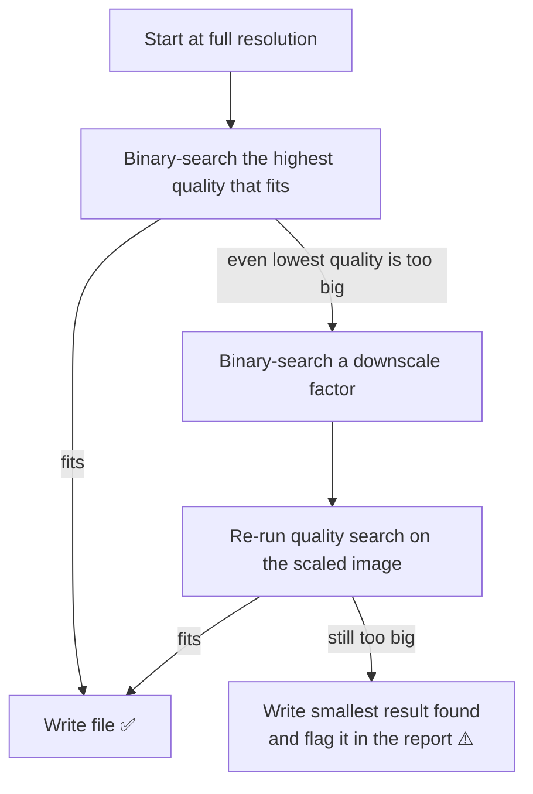

<div align="center">

# 🗜️ image-shrinker

**Shrink images in your terminal — without making them look worse.**

A fast terminal UI and CLI that re-encodes images to JPEG, WebP, PNG or AVIF,
either at a fixed quality or by automatically finding the best quality/scale
that fits under a target file size.

[](https://www.python.org/)
[](https://python-pillow.org/)
[](https://textual.textualize.io/)
[](LICENSE)

[Features](#-features) ·
[Install](#-installation) ·
[Usage](#-usage) ·
[Target-size mode](#-how-target-size-mode-works) ·
[Contributing](#-contributing)

</div>

<!-- Tip: add a screenshot or GIF of the TUI here
<p align="center"></p>
-->

---

## ✨ Features

| | |
| --- | --- |
| 🖥️ **Terminal UI** | File queue, live preview, progress bar and log |
| 🎯 **Two modes** | `quality` — encode at a quality you choose<br>`target` — hit a max file size (binary-searches quality, then resolution) |
| 🎛️ **Presets** | Web (WebP) · Email (≤ 500 KB) · Social (1080) · Thumbnail · Lossless PNG |
| 🔄 **Formats** | Keep the original, or convert to JPEG / WebP / PNG / AVIF |
| 🏷️ **Metadata** | Optional EXIF retention, orientation respected |
| 🛡️ **Safety** | Dry-run estimates, skips already-optimal files, never overwrites unless asked |
| ⚡ **Parallel** | Multi-threaded with a configurable worker count |
| 📊 **Reports** | CSV export and one-key "open output folder" |
| 💾 **Persistent** | Settings are remembered between runs |

---

## 📦 Installation

**Requirements:** Python 3.10+, `pillow>=10.0`, `textual>=0.80`

```bash
git clone https://github.com/faridhafizh/image-shrinker.git
cd image-shrinker
pip install -r requirements.txt
```

> [!NOTE]
> AVIF output needs a Pillow build with AVIF support. The app detects this
> automatically and hides the option when it's unavailable.

---

## 🚀 Usage

### Terminal UI

```bash
python main.py
```

Start with files or folders already queued:

```bash
python main.py ~/Pictures/holiday ~/Desktop/logo.png
```

### Headless CLI

```bash
# Fixed quality, convert to WebP, cap longest side at 2048 px
python main.py --cli ~/Pictures --format webp --quality 80 --max-dim 2048

# Target mode: fit under 500 KB, write to ./optimized
python main.py --cli ~/Pictures/hero.jpg --target 500 --out ./optimized
```

### CLI options

| Flag | Description |
| --- | --- |
| `--cli` | Run headless, no TUI |
| `--format` | `keep`, `jpeg`, `webp`, `png`, `avif` |
| `--quality` | Fixed quality, 1–100 |
| `--target` | Max file size in KB (switches to target mode) |
| `--max-dim` | Longest side in pixels, `0` for no limit |
| `--out` | Output folder (default: next to the original) |
| `--overwrite` | Overwrite the original when the format is unchanged |
| `--keep-exif` | Preserve EXIF metadata |
| `--dry-run` | Estimate results without writing files |
| `--no-recursive` | Don't descend into subfolders |
| `--workers` | Number of parallel workers |
| `--preset` | Apply a preset first; other flags override it |

### TUI keybindings

| Key | Action | Key | Action |
| --- | --- | --- | --- |
| `Ctrl+O` | Browse files / folders | `F8` | Remove selected row |
| `F5` | Compress | `F9` | Clear the queue |
| `F6` | Estimate (dry run) | `F4` | Open output folder |
| `F7` | Write CSV report | `Ctrl+Q` | Quit |

---

## 🎯 How target-size mode works



1. Find the highest quality that fits while keeping the full resolution.
2. If even the lowest quality is too big, binary-search a downscale factor.
3. Re-run the quality search on the scaled image.

If the target still can't be reached, the file is written at the smallest size
found and flagged in the report.

---

## 📁 Output naming

Results are written next to the original with a `.min` suffix:

| Input | Output |
| --- | --- |
| `photo.jpg` → same format | `photo.min.jpg` |
| `photo.jpg` → WebP | `photo.min.webp` |
| Name collision | `photo.min-1.webp`, `photo.min-2.webp`, … |

Files that wouldn't get smaller are reported as **`already optimal`** and left
untouched.

---

## 🤝 Contributing

Contributions are welcome — issues, bug reports and pull requests alike.
Keep changes focused and explain *why* they're needed.

<details>
<summary><b>Development setup</b></summary>

```bash
git clone https://github.com/faridhafizh/image-shrinker.git
cd image-shrinker
python -m venv .venv
```

Activate the virtual environment:

```bash
# Windows
.\.venv\Scripts\activate

# macOS / Linux
source .venv/bin/activate
```

Install dependencies:

```bash
pip install -r requirements.txt
```

Run `python main.py` for the TUI or `python main.py --cli <paths>` for headless
mode. Please test **both** paths before opening a pull request.

</details>

---

## 📄 License

Released under the [MIT License](LICENSE) — free to use, modify and distribute,
including commercially, as long as the copyright notice is kept.

<div align="center">

Made with ☕ by [faridhafizh](https://github.com/faridhafizh)

</div>
